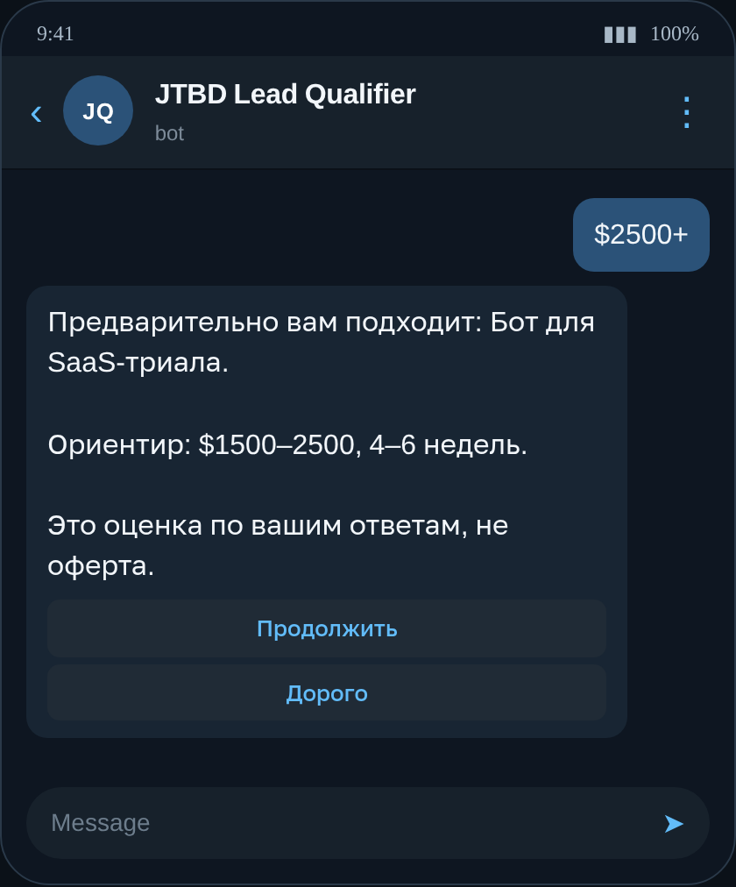

# JTBD Lead Qualifier

**Квалификация лидов для разработки ботов: JTBD-сценарий, пре-оффер и карточка лида.**

[](#запуск)
[](#как-устроено)
[](https://github.com/jefo/persona-forge)
[](#тесты)
[](LICENSE)

**[Открыть case study →](https://jefo.github.io/jtbd-lead-qualifier/)**



---

## Что это

Бот ведёт потенциального клиента по JTBD-сценарию: задача, контекст, боли, результат, дополнительные требования, сроки и бюджет. В конце показывает **пре-оффер** — модель бота, ориентир по цене и срокам — и передаёт менеджеру **карточку лида** с оценкой.

Это не LLM-бот. Сценарий, условия и оценка детерминированы: каждый переход и каждый балл можно проверить.

Собран на [PersonaForge](https://github.com/jefo/persona-forge): бот описан как FSM + ViewMap + форма, а не как набор обработчиков.

---

## Сценарий

```text
/start
  → имя
  → задача (мультивыбор)
  → канал (мультивыбор)
  → боль
  → желаемый результат
  → дополнительные требования (мультивыбор)
  → сроки
  → бюджет
  → пре-оффер
  → примеры
  → звонок
  → телефон
  → карточка лида менеджеру
```

Ветки:

- если в требованиях есть CRM — пре-оффер «Бот для SaaS-триала», $1500–2500, 4–6 недель;
- без CRM — «Бот для вебинарной воронки», $800–1200, 3–4 недели;
- «Дорого» — nurturing-ветка без звонка;
- «Пока не надо» — nurturing-ветка.

---

## Скоринг

Оценка от 0 до 9:

| Сигнал | Баллы |
| --- | --- |
| Бюджет $2500+ | +3 |
| Бюджет $1000–2500 | +2 |
| Бюджет до $1000 | +1 |
| Запуск 1–2 недели | +2 |
| Запуск в течение месяца | +1 |
| Нужна CRM | +1 |
| Нужны оплаты | +1 |
| Задача про продажи | +1 |
| Telegram как канал | +1 |

Температура: **горячий** от 5, **тёплый** от 3, иначе **холодный**. В карточке лида перечислены причины, которые дали баллы.

---

## Запуск

Нужен [Bun](https://bun.com) и токен от [@BotFather](https://t.me/BotFather).

```bash
bun install
cp .env.example .env
```

В `.env`:

```env
BOT_TOKEN=123456:AA...
MANAGER_CHAT_ID=123456789
```

```bash
bun run start
```

`/start` в Telegram запускает сценарий. Карточка лида уходит в `MANAGER_CHAT_ID`.

Проверки и демо:

```bash
bun test
bunx tsc --noEmit
bun run demo
```

`bun run demo` проигрывает весь сценарий в консоли и печатает карточку лида.

---

## Структура

```text
src/
├── bot/
│   └── definition.ts      FSM + экраны + форма
├── telegram/
│   └── adapter.ts         polling, callback-кнопки, отправка лида
├── scoring/
│   └── lead-score.ts      баллы, температура, карточка
├── demo.ts                консольный прогон
└── index.ts               запуск Telegram-бота
```

---

## Как устроено

- **`definition.ts`** — весь сценарий данными: 15 состояний, мультивыбор через `{ op: "add" }`, условный переход по CRM, объект `estimate`, тексты с `{{поля}}`.
- **`adapter.ts`** — long polling Telegram, `callback_data` с событием и индексом кнопки, ответ на callback, отправка карточки менеджеру.
- **`lead-score.ts`** — чистая функция оценки; никаких внешних сервисов.
- **`persona-forge`** — движок: инварианты, переходы, форма, рендер. Приложение не содержит собственного runtime.

Поток:

```text
Telegram update
  → JtbdTelegramBot
  → PersonaForge engine
  → Conversation + Form
  → RenderedMessage
  → Telegram sendMessage
  → final: formatLeadCard()
```

---

## Тесты

```text
7 pass
0 fail
28 expect() calls
```

Покрыто:

- полный сценарий до заявки;
- ветка с CRM и без CRM;
- nurturing-ветка при «Дорого»;
- скоринг горячего и холодного лида;
- старт по `/start`;
- переход по callback-кнопке;
- отправка карточки лида менеджеру.

---

## Ограничения

- **Состояние in-memory.** При перезапуске активные диалоги теряются.
- **Нет CRM.** Карточка уходит в один Telegram-чат, статусы лида не ведутся.
- **Нет календаря и оплаты.** «Звонок» — это сбор телефона, а не бронирование слота.
- **Скоринг эвристический.** 9 баллов и фиксированные правила, не ML.
- **Нет LLM.** Тексты и пре-оффер шаблонные.
- **Нет аналитики.** Воронка и конверсия не собираются.
- **Один активный диалог на чат.** Без конкурентности и блокировок.
- **Телефон текстом.** Без `request_contact` и валидации номера.

---

## Откуда взялось

Сценарий и JTBD-подход выросли из `dlg-ngind` — проекта квалификации лидов для услуги разработки ботов на Kwork. Там были 15 состояний, мультивыбор, пре-оффер и ветка nurturing.

Этот репозиторий — рабочая версия того же сценария на PersonaForge: движок вынесен в отдельный пакет, приложение содержит только определение бота, адаптер и скоринг.

---

## Что дальше

- Postgres/Redis для диалогов и лидов.
- CRM-интеграция и статусы.
- `request_contact` и нормализация телефона.
- Календарь для реального бронирования звонка.
- Аналитика воронки: старт → пре-оффер → звонок.
- A/B-тесты текстов и пре-оффера.
- LLM-резюме диалога для менеджера — поверх детерминированных данных.

---

## Лицензия

MIT.
